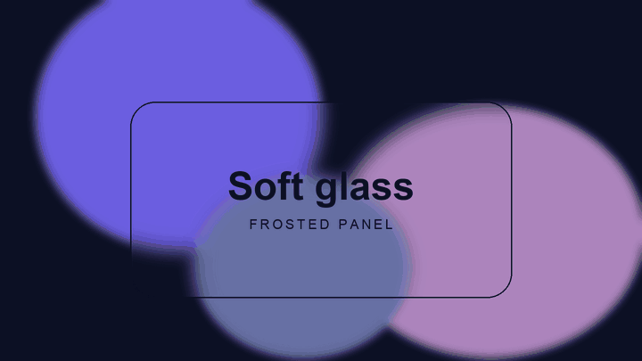
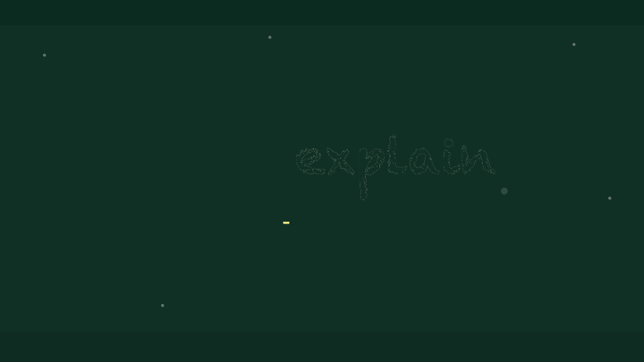
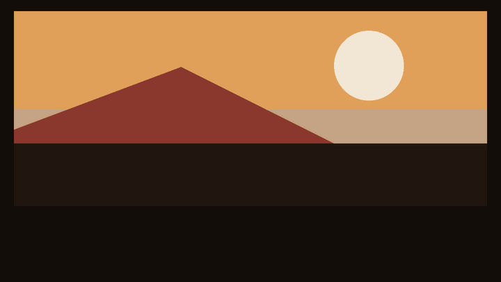
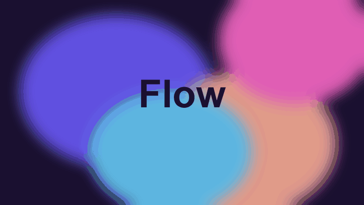

# Motion graphic style library

Fourteen Python libraries that describe how an explainer should look and move, and agent skills that apply those looks. A style decides the palette, the type, the shape, and the named animation clips. It does not render the video. An agent implements the clips in whatever runtime the project already uses.

Each tile below is a looping study of that style's real clips.

<table>
  <tr>
    <td align="center" width="25%">
      
      <br><b>Editorial Swiss</b>
      <br><sub>A wipe, a grid, one red.</sub>
    </td>
    <td align="center" width="25%">
      
      <br><b>Kinetic Type</b>
      <br><sub>The word slams in.</sub>
    </td>
    <td align="center" width="25%">
      
      <br><b>Soft Glass</b>
      <br><sub>A frosted panel floats.</sub>
    </td>
    <td align="center" width="25%">
      
      <br><b>Neo-Brutalist</b>
      <br><sub>A card pops into its shadow.</sub>
    </td>
  </tr>
  <tr>
    <td align="center">
      
      <br><b>Chalk Classroom</b>
      <br><sub>The line draws itself.</sub>
    </td>
    <td align="center">
      
      <br><b>Isometric Studio</b>
      <br><sub>Blocks assemble on the floor.</sub>
    </td>
    <td align="center">
      
      <br><b>Data Signal</b>
      <br><sub>Bars grow. The line draws.</sub>
    </td>
    <td align="center">
      
      <br><b>Paper Cut</b>
      <br><sub>Sheets slide into a stack.</sub>
    </td>
  </tr>
  <tr>
    <td align="center">
      
      <br><b>Neon Night</b>
      <br><sub>The sign flickers, then holds.</sub>
    </td>
    <td align="center">
      
      <br><b>Warm Documentary</b>
      <br><sub>A slow push, then a lower third.</sub>
    </td>
    <td align="center">
      
      <br><b>Playful Flat</b>
      <br><sub>Shapes hop into place.</sub>
    </td>
    <td align="center">
      
      <br><b>Blueprint</b>
      <br><sub>The plan draws, then the measure.</sub>
    </td>
  </tr>
  <tr>
    <td align="center">
      
      <br><b>Liquid Gradient</b>
      <br><sub>Color drifts. One word holds.</sub>
    </td>
    <td align="center">
      
      <br><b>Comic Pop</b>
      <br><sub>A burst hits, then the bubble.</sub>
    </td>
    <td></td>
    <td></td>
  </tr>
</table>

The GIFs above play in this README. [`docs/gallery.html`](docs/gallery.html) is the same set of studies as CSS animations. Open that file in a browser.

## The libraries

| Library | Import | Use it for | Motion |
| --- | --- | --- | --- |
| `motionstyle_swiss` | `from motionstyle_swiss import STYLE` | Strategy, essays, serious software | Wipes and tracking. No bounce. |
| `motionstyle_kinetic` | `from motionstyle_kinetic import STYLE` | Hooks, titles, manifesto lines | A word slams, then the next. |
| `motionstyle_glass` | `from motionstyle_glass import STYLE` | AI, fintech, calm tours | Panels float. Blur stays still. |
| `motionstyle_brutalist` | `from motionstyle_brutalist import STYLE` | Teaching explainers, how-tos | Springs. Hard shadows. |
| `motionstyle_chalk` | `from motionstyle_chalk import STYLE` | Lessons and how-it-works | Strokes draw on. |
| `motionstyle_isometric` | `from motionstyle_isometric import STYLE` | Systems, pipelines, maps | Blocks drop and settle. |
| `motionstyle_signal` | `from motionstyle_signal import STYLE` | Metrics, research, earnings | Bars grow, numbers count. |
| `motionstyle_papercut` | `from motionstyle_papercut import STYLE` | Stories, consumer brands | Sheets stack, back to front. |
| `motionstyle_neon` | `from motionstyle_neon import STYLE` | Launches, games, music | One flicker, then a pulse. |
| `motionstyle_documentary` | `from motionstyle_documentary import STYLE` | Origin stories, interviews | Ken Burns and a lower third. |
| `motionstyle_playful` | `from motionstyle_playful import STYLE` | Onboarding, friendly apps | Squash, stretch, one bob. |
| `motionstyle_blueprint` | `from motionstyle_blueprint import STYLE` | Engineering, process | The line draws, then the label. |
| `motionstyle_gradient` | `from motionstyle_gradient import STYLE` | Brand films, premium product | Slow fields, one line of type. |
| `motionstyle_comic` | `from motionstyle_comic import STYLE` | Social explainers, contrasts | One hit, then a hold. |

Full specs, including every hex and every keyframe, are in [`catalog/`](catalog/).

## Use a style from Python

```bash
pip install -e ".[preview]"
python -m motionstyles list
python -m motionstyles export glass --format md -o style.md
python -m motionstyles export glass --format ts -o theme.ts
python -m motionstyles export glass --format css -o theme.css
```

From a checkout of this repo:

```bash
pip install "motionstyles[preview] @ git+https://github.com/TheRollerBlader/motion-graphic-style-library.git"
```

```python
from motionstyle_kinetic import STYLE
from motionstyle_core import sample_clip

slam = STYLE.clip("slam_scale")
scale = sample_clip(slam, 0.2)  # eased value, in the clip's unit
print(STYLE.name, scale)
print(STYLE.to_style_md())
```

`sample_clip` applies the easing inside each keyframe span and holds the last value after the clip ends. `strokeOffset` runs from 1 (hidden) to 0 (drawn). `progress` runs from 0 to 1 for counts and fills.

A style also exports:

- `to_style_md()` for an explainer agent's `style.md`
- `to_json()` for clip data
- `to_css()` for custom properties, including `--duration-*` and `--ease-*`
- `to_theme_ts()` for a Remotion theme module

## Agent skills

Skills live in [`.cursor/skills`](.cursor/skills). Open this repo in Cursor and ask for an explainer.

- [`apply-motion-style`](.cursor/skills/apply-motion-style/SKILL.md) picks one library and applies it.
- `style-swiss`, `style-kinetic`, `style-glass`, and the rest of the `style-*` skills hold the rules and the full spec for that look.

The skills are generated from the Python libraries, so the hex values cannot drift:

```bash
python -m motionstyles skills
```

An agent building a beat should:

1. Choose one style and export it.
2. Build that style's primitives once, then reuse them.
3. Give each spoken idea one picture of the thing being named.
4. Play the named clips. Do not invent a second easing.
5. Start a word's animation on that word's timestamp.
6. Keep the idle clip running so a hold never freezes.

## What a style locks

Every library is a closed spec.

- **Palette.** Background, ink, primary, accent, and the semantic colors. No extra hex.
- **Type.** Display, body, and mono, with weight, tracking, and case.
- **Shape.** Radius, border, shadow, and blur. A brutalist shadow is a hard offset. A glass shadow is not.
- **Motion.** Named clips and, where the style is physical, springs. Stagger time. An idle so holds stay alive.
- **Grammar.** The primitives, the caption, and the do / don't list.

Canvas for every style is 1920×1080 at 30 frames per second, with a 96px safe margin. A vertical cut reflows. It does not recolor.

## Project layout

```
src/motionstyle_core/        model, sampling, exporters, previews
src/motionstyle_<name>/      one library per style
src/motionstyles/            catalog and the command line
catalog/                     style.md for every library
previews/                    looping GIF studies
docs/gallery.html            the same studies as CSS
.cursor/skills/              agent skills
```

## Develop

```bash
python -m venv .venv
source .venv/bin/activate
pip install -e ".[dev]"
pytest
python -m motionstyles previews previews
python -m motionstyles gallery
python -m motionstyles export-all catalog
```

Regenerate the skills, the catalog, the gallery, and the GIFs after changing a library. The tests check that the README, the gallery, and the skills still mention every style.

## License

[MIT](LICENSE)
